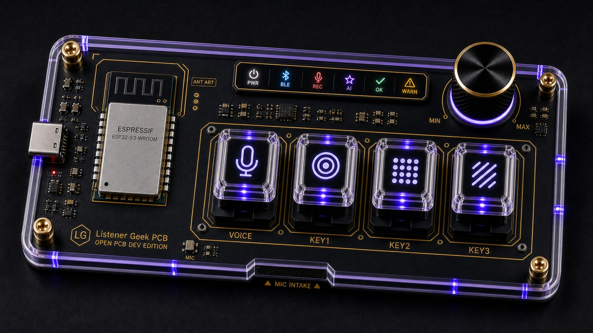
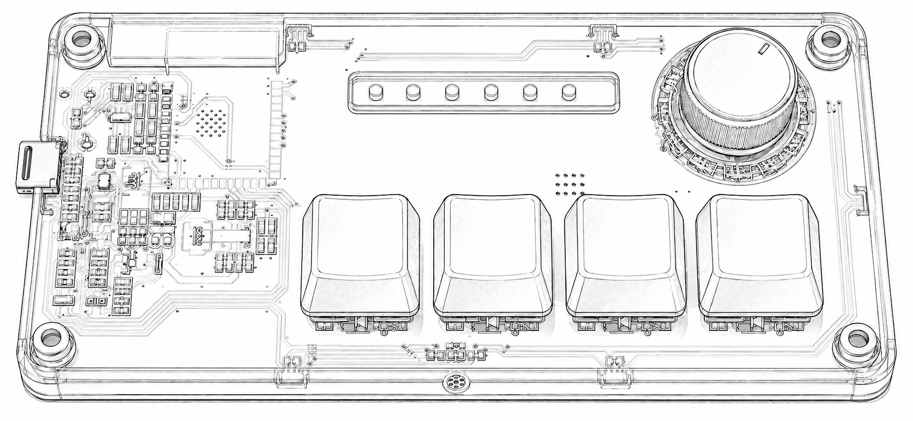

# Listener

## An AI starter gadget for your desk · US$49

A microphone, a recording knob and four customizable keys. Speak a message, email or note into the field you are using with Windows Type.

**US$49 is the hardware price. Type is free and open source.**

| Purpose | Direct download |
| --- | --- |
| **Windows app** | **[Download MSI · Type build165](https://github.com/Listener-ai-Macau/Listener-Type/releases/download/v1.0.6-rc1/ListenerType_1.0.6-rc1_x64_en-US.msi)** |
| **Firmware: USB flashing / Bluetooth OTA** | **[Download firmware ZIP · both methods](https://github.com/Listener-ai-Macau/Listener-Firmware/releases/download/v1.0.6-rc1/ListenerFirmware_1.0.6-rc1_ESP32S3.zip)** |

**English** · [简体中文](README.zh-CN.md) · [繁體中文](README.zh-TW.md)



*Actual Listener hardware. Planned appearance: transparent case and keycaps, black knob, broadly as shown. This is a photograph, not an operation video.*

- **Say it:** the knob starts and stops dictation; Type handles recognition and writing on the computer.
- **Shape the words:** keep the original by default, or choose a text style or translation with a configured text service.
- **Make it yours:** assign the four keys and adjust lights or power settings. Each device keeps its own settings.

**[Hear a short message become text · 25-second software example](https://github.com/Listener-ai-Macau/Listener-Type/blob/master/docs/VOICE_EXAMPLE.md).** Prerecorded synthetic voice and actual Type results; no hardware operation shown.

**Before you start:** the full hardware-audio path needs Windows Type and a configured recognition service or local model. Cloud usage is billed separately; no ready-to-use official cloud account or allowance is included in this release.

**RC1 is a prerelease.** Strong-interference separation is incomplete and intermittent early-close cases remain under review. [Current limits and release notes](https://github.com/Listener-ai-Macau/Listener-Type/releases/tag/v1.0.6-rc1). Hardware purchase link not yet announced.

[First setup](https://github.com/Listener-ai-Macau/Listener-Type#make-your-first-dictation) · [Look through the user guide when needed](https://github.com/Listener-ai-Macau/Listener-Type/blob/master/docs/USAGE.en.md)

<details>
<summary>Already have a device? Firmware, settings and current build</summary>

Firmware: **ESP32-S3 N16R8**, build `9d7fbbe67ed0223d`. Select the same ZIP for USB flashing or Bluetooth OTA in Type.
Type defaults to **USB wired flashing**, with the flasher included in the MSI. No Python, ESP-IDF or separate flashing software is required.
Device settings are independent: select one USB/Bluetooth device and read its settings. Explicit edits save automatically when editing finishes; reading or switching devices does not write computer defaults. Names, lights, power, keys and knob settings stay on the selected board. Use this paired MSI and firmware ZIP.

Type build165 lets local text users launch without an automatic speech-setup popup. Overview retains speech readiness and explicit setup. History names dictation and Q&A records, with saved text available separately in Saved drafts. Existing local Chinese ↔ English translation and Firmware37 are unchanged.

[Release notes / 发布说明](https://github.com/Listener-ai-Macau/Listener-Type/releases/tag/v1.0.6-rc1) · [Firmware / 固件](https://github.com/Listener-ai-Macau/Listener-Firmware/releases/tag/v1.0.6-rc1)

</details>

---

## From power-on to the first sentence

1. Install and open [Listener Type](https://github.com/Listener-ai-Macau/Listener-Type/releases). Configure recognition-provider credentials or prepare a local model.
2. Charge over USB-C and click the knob to power on.
3. Start pairing in Type → Settings → Device. Select `listener` in Windows Bluetooth and check the connection in Type.
4. Select Listener BLE input, focus a field and click the knob. Speak, then click again to stop.

Bluetooth “paired” alone does not mean Type is ready. Windows is the primary full hardware-audio path.

The companion Type app is free and open source; cloud recognition and text services bill separately. Without an API key, try a Windows local model with Raw. See [app setup and costs](https://github.com/Listener-ai-Macau/Listener-Type#free-app-separate-service-costs).

<picture>
  <source media="(prefers-color-scheme: dark)" srcset="docs/assets/listener/keyboard-lineart-dark.png">
  
</picture>

## A state you can see

| Light | Color and rhythm |
| --- | --- |
| PWR | Green / amber / red battery; red double-blink at critical level. White breathing charges; solid white is full |
| BLE | Blue pulses: pairing/reconnect. Dim blue double: Type not ready. Solid blue: ready |
| REC | Gold follows audio while recording |
| AI | Purple rhythm during transfer or processing |
| OK | Brief green on completion; cyan-green progress during OTA |
| WARN | Amber or red: check the app's error message |

[Full light language](docs/features/status_led.md). Read labels and rhythms as well as colors.

## Defaults you can make your own

| Control | Default |
| --- | --- |
| Knob click / rotation | Toggle dictation / system volume |
| Knob double-click / hold | Reset pairing / hold until shutdown confirms |
| KEY1 / KEY2 / KEY3 / KEY4 | Right Ctrl / Ctrl+C / Ctrl+V / Enter |

Key double-click and long-press actions default to disabled. Assign dictation, templates, shortcuts and other actions in Type's Device page. Status, key, knob and edge brightness are independently adjustable.

Wake phrase and voiceprint are configured on the same page. Without enrollment, anyone saying the phrase may trigger recording. Deleting a voiceprint does not disable wake. With wake enabled, REC off does not mean the microphone is fully off.

## Rest when idle, wake when needed

Battery defaults: low power after about one idle minute, shutdown after ten. USB defaults: low power after three minutes, no automatic shutdown. Low-power mode retains power feedback and wakes on a key or knob action. Use the knob after actual shutdown. Timers and brightness are configurable.

## Update and recover

Use a matching release OTA ZIP in Type's Device page. Keep power and connection stable; verify the version after reboot. Normal OTA preserves pairing and settings. Knob pairing reset is different from engineering full erase.

## Development

This is the open-source firmware repository for the Listener voice keyboard. The keyboard sends audio over Bluetooth to Listener Type; the computer handles recognition and text insertion. The companion app is required.

| Directory | Contents |
| --- | --- |
| `components/` | Controls, lights, power, settings, OTA and diagnostics |
| `ports/esp32/` | Audio, BLE, storage and board bindings |
| `protocols/` | Device protocols and codecs |
| `tools/` | Build, flash, monitor, package and validation scripts |

```powershell
pwsh -NoProfile -File .\tools\setup_windows.ps1
pwsh -NoProfile -File .\tools\build.ps1
pwsh -NoProfile -File .\tools\flash.ps1 -Port COMx
pwsh -NoProfile -File .\tools\monitor.ps1 -Port COMx
```

Use `tools/idf.ps1` for ad hoc ESP-IDF commands. Continue with [Contributing](CONTRIBUTING.md) and the [feature map](docs/features/firmware-feature-map.md).

[Security](SECURITY.md)

[Apache-2.0](https://github.com/Listener-ai-Macau/Listener-Firmware/blob/master/LICENSE)
